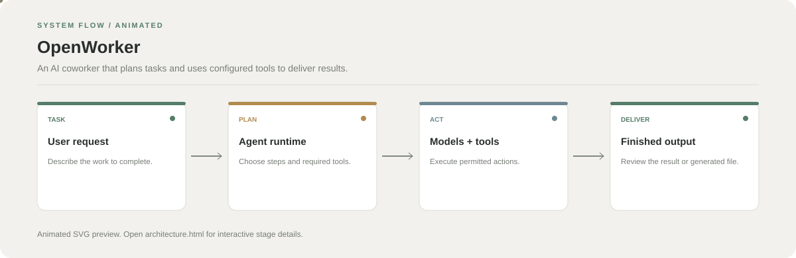

# OpenWorker

**An AI coworker that plans tasks and uses configured tools to deliver results.**

[](https://github.com/chyk2468/openworker)

## 1. Project Title & Tagline

An AI coworker that plans tasks and uses configured tools to deliver results.

## 2. Problem Statement

Complex computer tasks often require switching between planning, tools, and output files. OpenWorker aims to coordinate those steps in one agent workflow.

## 3. Project Preview

Add a screenshot or GIF showing the current workflow and output. For notebook repositories, use a representative result figure.

[Open interactive architecture](architecture.html)

## 4. Overview

The repository organises the task into input, processing, and result stages. Use the source files and notebook outputs to verify the exact implementation details.

## 5. Key Features

- Accept a task description.
- Plan a sequence of steps.
- Use configured models and authorised tools.
- Return the resulting work for review.

## 6. Architecture / Workflow



Open the [interactive architecture explorer](architecture.html) to select a stage and inspect its role.

## 7. Tech Stack

Python, agent runtime, model providers, and integrations configured by the repository

## 8. Installation & Setup

```bash
git clone https://github.com/chyk2468/openworker.git
cd openworker
```

Follow the repository's package manager and runtime setup instructions, then configure the model provider and permitted tools.

## 9. Usage

Start the application using the documented command, give it a small task, inspect the proposed plan, and review any actions and generated files before using them.

## 10. Project Structure

Inspect the main app entry point, agent runtime, model adapters, tool integrations, and configuration files.

## 11. Results & Demo

Add a demo showing a request, plan, tool activity, and delivered result. Document the tested model and enabled integrations.

## 12. Future Enhancements

- Improve permissions and action confirmation.
- Add tests for tool failures and retries.
- Expose task progress and cancellation.
- Document local and remote model options.

## 13. License

Check the repository and model/integration licences before reuse.
